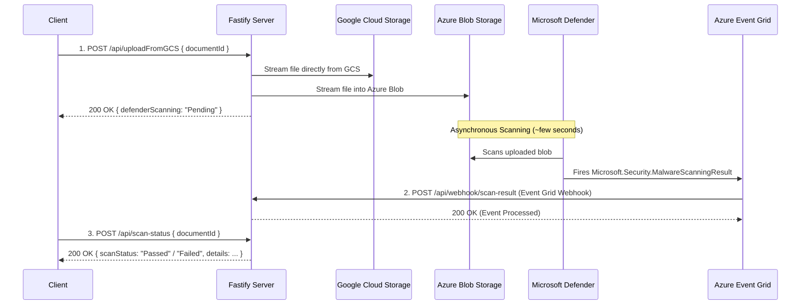

# Fastify Multi-Cloud Storage Service (GCS & Azure Blob with Defender Scanning)

A production-ready Fastify microservice written in TypeScript for:
1. Streaming file uploads directly to **Google Cloud Storage (GCS)**.
2. Generating secure, time-limited V4 signed URLs for downloading GCS documents via `documentId`.
3. Transferring documents from **GCS to Azure Blob Storage** (`POST /api/uploadFromGCS`).
4. **Microsoft Defender for Storage** integration:
   - Webhook receiver (`POST /api/webhook/scan-result`) for Azure Event Grid validation handshakes and asynchronous malware scanning results (`Microsoft.Security.MalwareScanningResult`).
   - Query endpoint (`POST /api/scan-status`) to check if a document passed or failed malware scanning.
5. 100% free local testing for Azure using **Azurite** emulator.

---

## Architecture & Malware Scanning Flow

Microsoft Defender for Storage scans blobs **asynchronously** (takes a few seconds after upload). Results are pushed via **Azure Event Grid** to your webhook:



---

## Features

- **Direct Streaming Upload (`POST /api/upload`)**: Streams multipart file uploads directly to GCS via Node.js pipelines without disk buffering.
- **Signed URL Download (`POST /api/download`)**: Generates secure, time-limited GCS V4 signed download URLs using `documentId`.
- **GCS to Azure Transfer (`POST /api/uploadFromGCS`)**: Streams a file directly from GCS to Azure Blob Storage container (`scanned-documents`).
- **Event Grid Webhook (`POST /api/webhook/scan-result`)**:
  - Handles one-time **Subscription Validation Handshake** (`Microsoft.EventGrid.SubscriptionValidationEvent`).
  - Receives live **Malware Scan Results** (`Microsoft.Security.MalwareScanningResult`).
- **Scan Status Check (`POST /api/scan-status`)**: Query whether a file is `Pending`, `Passed` (`No threats found`), or `Failed` (`Malicious`), including malware names and SHA256 hashes.
- **Zero-Cost Azure Testing**: Uses Azurite local emulator with zero cloud costs or credit card required.
- **Modular Architecture**: Clean separation of Controllers, Services, Schemas, and Utils.

---

## Prerequisites

- **Node.js**: v20 or v22+
- **Google Cloud Platform**:
  - GCS Bucket name.
  - Service Account credentials (`GOOGLE_APPLICATION_CREDENTIALS`).
- **Azure**:
  - Local testing: Azurite (installed as dev dependency, runs with `npm run azurite`).
  - Production Azure: Azure Storage connection string.

---

## Setup & Configuration

1. **Install dependencies:**
   ```bash
   npm install
   ```

2. **Configure Environment Variables:**
   Copy `.env.example` to `.env`:
   ```bash
   cp .env.example .env
   ```

   Variables in `.env`:
   ```env
   PORT=3000
   HOST=0.0.0.0
   GCS_BUCKET_NAME=your-gcs-bucket-name
   GCP_PROJECT_ID=your-gcp-project-id
   GOOGLE_APPLICATION_CREDENTIALS=/path/to/service-account.json
   SIGNED_URL_EXPIRATION_MINUTES=15

   # Azure Blob Storage Configuration (Azurite emulator default)
   AZURE_STORAGE_CONNECTION_STRING=UseDevelopmentStorage=true
   AZURE_CONTAINER_NAME=scanned-documents
   ```

---

## Running the Application

### 1. Start Azurite (Local Azure Emulator)
In a separate terminal:
```bash
npm run azurite
```
*Azurite Blob service will listen on `http://127.0.0.1:10000`.*

### 2. Start Fastify Dev Server
```bash
npm run dev
```

### 3. Run Automated Tests
```bash
npm test
```

### 4. Build for Production
```bash
npm run build
npm start
```

---

## API Endpoints

### 1. Upload to GCS (`POST /api/upload`)
- **Method**: `POST`
- **Path**: `/api/upload`
- **Content-Type**: `multipart/form-data`
- **Field Name**: `file`

```bash
curl -X POST http://localhost:3000/api/upload \
  -F "file=@test-file.txt"
```
**Response (`201 Created`):**
```json
{
  "success": true,
  "message": "File successfully uploaded to Google Cloud Storage",
  "data": {
    "documentId": "53948ca4-8ee0-4ce0-b5c3-646acbcfdb4e.txt",
    "originalFileName": "test-file.txt",
    "contentType": "text/plain",
    "bucket": "your-gcs-bucket"
  }
}
```

---

### 2. Generate GCS Signed Download URL (`POST /api/download`)
- **Method**: `POST`
- **Path**: `/api/download`
- **Content-Type**: `application/json`

```bash
curl -X POST http://localhost:3000/api/download \
  -H "Content-Type: application/json" \
  -d '{
    "documentId": "53948ca4-8ee0-4ce0-b5c3-646acbcfdb4e.txt",
    "expiresInMinutes": 15
  }'
```
**Response (`200 OK`):**
```json
{
  "success": true,
  "message": "Signed download URL generated successfully",
  "data": {
    "documentId": "53948ca4-8ee0-4ce0-b5c3-646acbcfdb4e.txt",
    "downloadUrl": "https://storage.googleapis.com/your-bucket/53948ca4...?X-Goog-Algorithm=...",
    "expiresAt": "2026-11-16T10:22:50.357Z",
    "contentType": "text/plain",
    "size": 41
  }
}
```

---

### 3. Transfer from GCS to Azure Blob (`POST /api/uploadFromGCS`)
Streams a document from Google Cloud Storage directly into Azure Blob Storage.

- **Method**: `POST`
- **Path**: `/api/uploadFromGCS`
- **Content-Type**: `application/json`

```bash
curl -X POST http://localhost:3000/api/uploadFromGCS \
  -H "Content-Type: application/json" \
  -d '{"documentId": "53948ca4-8ee0-4ce0-b5c3-646acbcfdb4e.txt"}'
```

**Response (`200 OK`):**
```json
{
  "success": true,
  "message": "File successfully transferred from GCS to Azure Blob Storage and scanned by Defender",
  "data": {
    "documentId": "53948ca4-8ee0-4ce0-b5c3-646acbcfdb4e.txt",
    "source": {
      "provider": "Google Cloud Storage",
      "bucket": "your-gcs-bucket",
      "originalFileName": "test-file.txt",
      "contentType": "text/plain",
      "size": 41
    },
    "destination": {
      "provider": "Azure Blob Storage",
      "container": "scanned-documents",
      "blobName": "53948ca4-8ee0-4ce0-b5c3-646acbcfdb4e.txt",
      "blobUrl": "http://127.0.0.1:10000/devstoreaccount1/scanned-documents/53948ca4-8ee0-4ce0-b5c3-646acbcfdb4e.txt",
      "etag": "\"0x2768686A562C080\"",
      "lastModified": "2026-11-16T19:05:19.000Z",
      "defenderScanning": {
        "status": "Pending",
        "message": "Defender for Storage will scan this blob asynchronously. Results are delivered via Event Grid to POST /api/webhook/scan-result. Query scan status with POST /api/scan-status.",
        "webhookEndpoint": "/api/webhook/scan-result"
      }
    }
  }
}
```

---

### 4. Check Malware Scan Status (`POST /api/scan-status`)
Query whether a transferred document has been scanned and the scan result.

- **Method**: `POST`
- **Path**: `/api/scan-status`
- **Content-Type**: `application/json`

```bash
curl -X POST http://localhost:3000/api/scan-status \
  -H "Content-Type: application/json" \
  -d '{"documentId": "53948ca4-8ee0-4ce0-b5c3-646acbcfdb4e.txt"}'
```

#### If Scan is in progress:
```json
{
  "success": true,
  "data": {
    "documentId": "53948ca4-8ee0-4ce0-b5c3-646acbcfdb4e.txt",
    "scanStatus": "Pending",
    "message": "Scan result not yet received. Defender scanning is asynchronous — results typically arrive within seconds of upload."
  }
}
```

#### When Clean (`Passed`):
```json
{
  "success": true,
  "data": {
    "documentId": "53948ca4-8ee0-4ce0-b5c3-646acbcfdb4e.txt",
    "scanStatus": "Passed",
    "scanResult": "No threats found",
    "scanFinishedAt": "2026-11-16T19:30:00.000Z",
    "malwareNames": [],
    "blobUri": "https://mystorageaccount.blob.core.windows.net/scanned-documents/53948ca4-8ee0-4ce0-b5c3-646acbcfdb4e.txt",
    "correlationId": "corr-abc-123",
    "receivedAt": "2026-11-16T19:30:30.372Z"
  }
}
```

#### When Infected (`Failed`):
```json
{
  "success": true,
  "data": {
    "documentId": "infected-file.exe",
    "scanStatus": "Failed",
    "scanResult": "Malicious",
    "scanFinishedAt": "2026-11-16T19:31:00.000Z",
    "malwareNames": ["Trojan:Win32/Wacatac.B!ml"],
    "sha256": "e3b0c44298fc1c149afbf4c8996fb92427ae41e4649b934ca495991b7852b855",
    "blobUri": "https://mystorageaccount.blob.core.windows.net/scanned-documents/infected-file.exe",
    "correlationId": "corr-mal-456",
    "receivedAt": "2026-11-16T19:30:52.261Z"
  }
}
```

---

### 5. Azure Event Grid Webhook (`POST /api/webhook/scan-result`)
Receives Azure Event Grid callbacks automatically.

- **Handshake Validation**: When you register the webhook in Azure Event Grid, Azure sends `Microsoft.EventGrid.SubscriptionValidationEvent`. The endpoint automatically replies with the required `validationResponse` handshake.
- **Malware Results**: When scanning finishes, Event Grid posts `Microsoft.Security.MalwareScanningResult`. The controller records the result and logs any detected threats.

#### Setting up Event Grid in Azure Portal:
1. In Azure Portal, open your **Storage Account**.
2. Under **Security + networking**, click **Microsoft Defender for Cloud** and enable **Defender for Storage** with **Malware Scanning**.
3. In your Storage Account, click **Events** in the left menu > **+ Event Subscription**.
4. Configure the subscription:
   - **Name**: `defender-malware-scan-subscription`
   - **Event Types**: Select `Microsoft.Security.MalwareScanningResult`
   - **Endpoint Type**: `Web Hook`
   - **Endpoint**: `https://<your-public-server-domain>/api/webhook/scan-result`
5. Click **Create**. Event Grid will ping the endpoint, execute the validation handshake automatically, and activate!

---

### 6. Health Check (`GET /health`)
```bash
curl http://localhost:3000/health
```
```json
{
  "status": "ok",
  "timestamp": "2026-11-16T19:30:00.000Z",
  "uptimeSeconds": 120.4
}
```
